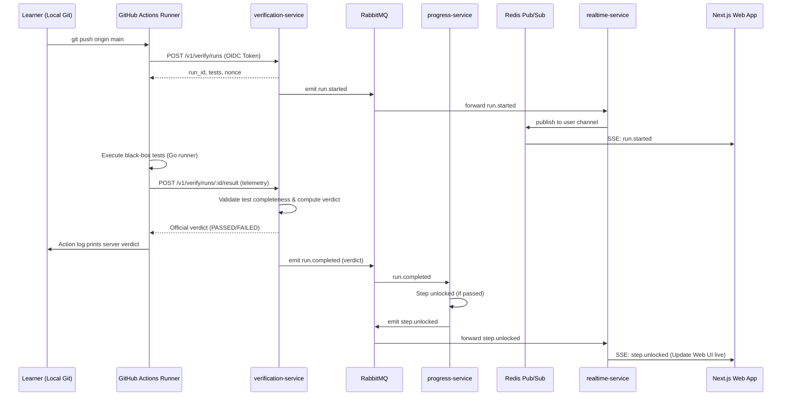

# Handrail Architecture Specification

## 1. Executive Summary & Goals
Handrail is a guided learn-by-building platform for engineers. Learners build real systems (e.g., "Build your own Redis") by downloading starter projects and developing locally in their own IDE. Testing and verification occur via GitHub Actions (Phase 1) and a reusable test runner package (prepped for a Phase 2 Go Cobra CLI).

### Core Differentiators
- **No In-Browser IDE**: Learners write code in their local editor and push to GitHub.
- **Strict Content Hierarchy**: `Workshop -> Chapters -> Steps`.
  - A *workshop* is one complete build project.
  - *Chapters* group steps only.
  - *Steps* are the atomic unit of work, theory, hints, acceptance criteria, and automated testing.
  - The terms "course" or "challenge" are strictly avoided in code, schemas, URLs, and UI.
- **Three-Level Content Depth**: Task, theory, and hints exist in three distinct depth levels (`beginner`, `intermediate`, `expert`). The learner can switch levels live in the UI without page reloads.
- **Server-Decided Verdicts**: The test runner executes tests against a local instance, posts structured run telemetry to the server via GitHub OIDC-authenticated endpoints, and the server computes and publishes the final pass/fail verdict.
- **Real-Time Feedback**: Step progress updates are pushed to the web UI via Server-Sent Events (SSE).

---

## 2. System Overview & Monorepo Layout

```
.
├── apps/
│   └── web/                     # Next.js App Router (TanStack Query, Zustand, Tailwind, Supabase)
├── services/
│   ├── api-gateway/             # Reverse proxy, JWT validation, rate limiting, SSE passthrough
│   ├── catalog-service/         # Workshop, Chapter, Step catalog and 3-level MDX content
│   ├── starter-service/         # Starter generation, MinIO/S3 artifact storage, signed URLs
│   ├── verification-service/    # GitHub OIDC verification, test specs, run evaluation, webhooks
│   ├── progress-service/        # Enrollment, step progression state, unlocks
│   └── realtime-service/        # Redis pub/sub to SSE bridge for user live feedback
├── packages/
│   ├── contracts/               # Shared Zod schemas, TypeScript DTOs, Event definitions
│   ├── auth/                    # Jose-based Supabase JWT validation (JWKS + HS256 fallback), NestJS guards
│   └── common/                  # Structured logging, Correlation IDs, NestJS filters, Health checks
├── tools/
│   └── runner/                  # Go test runner package (black-box TCP/HTTP/stdio test engine)
├── content/                     # Workshops, chapters, steps (3-level MDX), starters
├── infra/
│   ├── docker-compose.yml       # Local development backing services and microservices
│   ├── .env.example             # Global root environment reference
│   └── verify-workflow/         # Pinned reusable GitHub Actions workflow
└── docs/
    ├── architecture.md
    ├── assumptions.md
    └── adr/
```

---

## 3. Technology Stack

| Layer | Technology | Key Details |
|---|---|---|
| Monorepo Orchestration | Turborepo + pnpm Workspaces | Fast caching, strictly isolated packages |
| Frontend | Next.js 15 (App Router), TypeScript, Tailwind CSS | MDX rendering, Zustand (client/level state), TanStack Query |
| Authentication | Supabase Auth (Email + GitHub OAuth) | Validated via `jose` with JWKS endpoint; HS256 secret fallback |
| Microservices | NestJS (Fastify or Express HTTP adapter) | Modular architecture, OpenAPI `@nestjs/swagger`, microservice transport |
| Database | PostgreSQL 16 | One logical database, isolated schema per service (`catalog`, `starter`, etc.) |
| ORM / Migrations | Prisma ORM | Dedicated schema per service matching its DB schema |
| Event Bus | RabbitMQ | NestJS Microservices RabbitMQ transport for async decoupled events |
| Caching & Realtime | Redis 7 | Rate limiting, pub/sub for SSE stream multiplexing |
| Object Storage | MinIO (S3 Compatible) | Starter template archives and signed download URLs |
| Verification Engine | Go 1.22+ (`/tools/runner`) | Standalone runner core executing declarative tests, reporting to API |

---

## 4. Service Boundaries & Responsibilities

### 4.1 `api-gateway` (Port 4000)
- Single public entry point for client traffic.
- Validates Supabase JWTs at the perimeter, injecting verified user headers (`x-user-id`, `x-user-email`).
- Correlation ID propagation (`x-correlation-id`) via asynchronous local storage / request interceptor.
- Unbuffered SSE proxying for `/v1/realtime/events`.
- In-memory / Redis token-bucket rate limiting.

### 4.2 `catalog-service` (Port 4001)
- Serves public workshops, chapters, and steps.
- Handles 3-level content retrieval (`beginner`, `intermediate`, `expert`).
- Provides internal sync endpoint `POST /internal/content/sync` secured by CI HMAC token.
- Database schema: `catalog` (`workshops`, `workshop_languages`, `chapters`, `steps`, `step_tests`, `step_contents`).

### 4.3 `starter-service` (Port 4002)
- Bundles starter code templates for chosen `(workshop, language)`.
- Uploads starter ZIP archives to MinIO/S3.
- Generates pre-signed short-lived download URLs for enrolled learners.
- Database schema: `starter` (`starter_templates`).

### 4.4 `verification-service` (Port 4003)
- Handles GitHub App repository linking (`repo_links`).
- Validates GitHub OIDC tokens (`issuer`, `audience`, `job_workflow_ref`, branch, repo ID).
- Manages verification run lifecycle (`POST /v1/verify/runs` -> returns test bundle + randomized nonce).
- Validates test execution reports (`POST /v1/verify/runs/:id/result`), enforces that all required tests executed, computes verdict, and publishes `run.completed` event.
- Ingests GitHub `workflow_run` webhooks to cross-check execution authenticity.
- Database schema: `verification` (`repo_links`, `verify_runs`, `verify_attempts`, `webhook_events`).

### 4.5 `progress-service` (Port 4004)
- Tracks user enrollments: `(user_id, workshop_id, language)`.
- Tracks step progress: `LOCKED`, `AVAILABLE`, `COMPLETED`.
- Consumes `run.completed` events; when verdict is `PASSED`, marks the current step as `COMPLETED` and unlocks the subsequent step in `global_order`.
- Publishes `step.unlocked` events.
- Database schema: `progress` (`enrollments`, `step_progress`).

### 4.6 `realtime-service` (Port 4005)
- Subscribes to Redis channels for verification and progress events.
- Serves client SSE connections: `GET /v1/realtime/events`.
- Authenticates incoming SSE connections via user JWT.
- Streams real-time run statuses (`run.queued`, `run.started`, `run.progress`, `run.passed`, `run.failed`, `step.unlocked`).

---

## 5. Security & Authentication Model

1. **User Identity (Web & API)**:
   - Supabase issues RS256/ES256 JWTs containing `sub` (User UUID) and metadata.
   - Microservices and API Gateway fetch Supabase public keys via `jose.createRemoteJWKSet(new URL(jwksUri))` with in-memory caching.
   - For environments lacking JWKS access, an HS256 secret is supported as a fallback.
   - Services never trust client-supplied user IDs; `req.user.id` is derived strictly from the validated JWT token.

2. **Actions Verification Identity (GitHub OIDC)**:
   - GitHub Actions workflow requests an OIDC token (`actions/core.getIDToken('handrail-api')`).
   - `verification-service` verifies the OIDC token against `https://token.actions.githubusercontent.com`.
   - Validates claims:
     - `aud`: `handrail-api`
     - `repository_id`: matches enrolled learner's linked repository
     - `ref`: `refs/heads/main` or `refs/heads/master` (default branch)
     - `event_name`: `push`
     - `job_workflow_ref`: pinned Handrail reusable workflow ref.
   - Single-use policy: `(run_id, run_attempt)` is recorded and idempotently rejected if submitted multiple times.

3. **Internal Service-to-Service Communication**:
   - Asynchronous messaging via RabbitMQ queues.
   - Synchronous internal calls (e.g. content sync) use shared secret header tokens (`x-internal-token`).

---

## 6. Real-Time Event Flow



---

## 7. Go Test Runner Package Architecture (`/tools/runner`)
- Reusable package `pkg/runner` capable of executing:
  - TCP connectivity and protocol assertions (e.g. RESP parsing).
  - HTTP request/response assertions.
  - Stdio process spawning and stream checks.
- Interprets JSON test specifications provided by `verification-service`.
- Reports live test progress to stdout and posts structured results back.
- Designed with clean interfaces so Phase 2 Cobra CLI can import `pkg/runner` directly.

