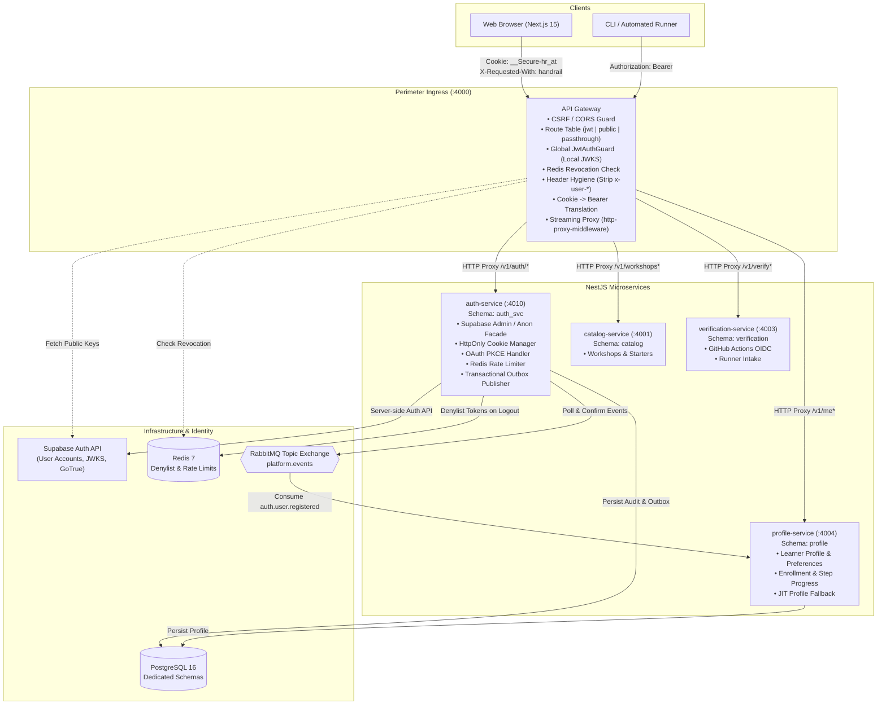
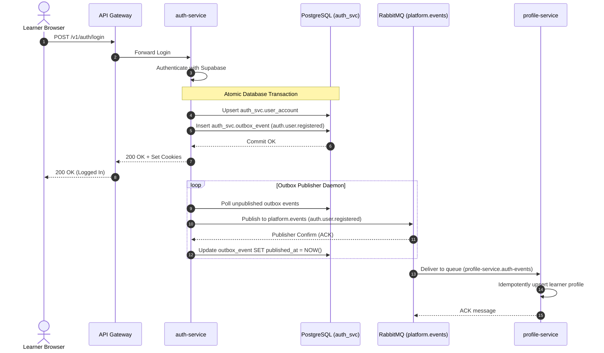

# Handrail Authentication & Authorization Architecture Specification

## 1. Executive Summary & System Overview

Handrail is a guided learn-by-building engineering platform. Learners develop software locally, commit and push to GitHub, and receive automated real-time verification and streaming progress feedback.

The identity and access management architecture follows a **zero-trust, edge-verifying, defense-in-depth model**:
- **Identity Provider**: **Supabase Auth** is the authoritative identity provider (user credentials, password hashing, OAuth identity brokering, email verification, and token signing).
- **Backend Auth Gateway**: The browser **never** communicates with Supabase directly. `apps/web` does **not** install or use `@supabase/supabase-js`.
- **`auth-service`**: Acts as an enterprise facade over Supabase Auth. It manages sessions via `HttpOnly` cookies, handles PKCE-secured GitHub OAuth, maps errors into stable application error codes, logs security audit events, and broadcasts lifecycle domain events via a Transactional Outbox pattern.
- **`api-gateway`**: Acts as the single perimeter ingress. It parses incoming cookie or Bearer tokens, executes local cryptographic verification via cached JWKS, checks Redis token revocation denylists, sanitizes internal request headers, enforces CSRF protections, and proxies traffic with unbuffered HTTP streaming.
- **Shared Library (`@app/auth`)**: Standardized NestJS security module registered across all downstream microservices to verify tokens locally with default-deny semantics.
- **`profile-service`**: Consumes `auth.user.registered` domain events to manage learner profiles, default preferences, and step progression.



---

## 2. Client Authentication & Cookie Architecture

### 2.1 Browser vs. Non-Browser Clients
- **Browser Clients (`apps/web`)**: Never access raw JWTs or refresh tokens in JavaScript memory or `localStorage`. Authentication tokens are stored exclusively in secure, `HttpOnly` cookies set and refreshed by `auth-service`.
- **Non-Browser Clients (CI Runners, Test Harnesses, CLI)**: Pass the standard `Authorization: Bearer <JWT>` header.

### 2.2 Cookie Specifications
`auth-service` issues two dedicated cookies:

| Cookie Name | Scope / Path | Max-Age | Attributes | Purpose |
| :--- | :--- | :--- | :--- | :--- |
| `__Secure-hr_at` | `Path=/` | Equals Access Token TTL (15–30 min) | `HttpOnly`, `SameSite=Lax`, `Secure`, `Domain=<CONFIGURED>` | Session access token for authenticated API requests |
| `__Secure-hr_rt` | `Path=/v1/auth` | Long-lived (e.g., 30 days) | `HttpOnly`, `SameSite=Lax`, `Secure`, `Domain=<CONFIGURED>` | Single-use refresh token scoped strictly to auth endpoints |

#### Environment Adaptability
- In **Production**: The `__Secure-` prefix and the `Secure` attribute are mandatory.
- In **Localhost Development**: The cookie name prefix (`__Secure-`) and the `Secure` flag are configurable via `COOKIE_SECURE=false` and `COOKIE_PREFIX_ENABLED=false` to allow unencrypted HTTP on `localhost`.
- **Domain**: Configured via `COOKIE_DOMAIN` (e.g., `.handrail.dev` in staging/production, omitted or `localhost` in local development) to allow seamless cross-subdomain sharing between `app.handrail.dev` and `api.handrail.dev`.

---

## 3. Threat Model, CSRF & CORS Security

### 3.1 CSRF Defense
Because browser authentication uses cookies, all mutating endpoints are vulnerable to Cross-Site Request Forgery unless strictly mitigated. Handrail employs a multi-layered defense:
1. **`SameSite=Lax` Cookie Policy**: Browsers refuse to send the session cookie on cross-site subrequests (e.g., `fetch`, `XMLHttpRequest`, images, iframes).
2. **Mandatory Custom Request Header**: Every non-idempotent (`POST`, `PUT`, `PATCH`, `DELETE`) request carrying cookie authentication **must** include:
   ```http
   X-Requested-With: handrail
   ```
   Cross-origin attackers cannot forge custom headers in cross-origin requests without triggering a preflight `OPTIONS` check.
3. **Origin & Referer Validation**: The gateway checks incoming `Origin` (falling back to `Referer` if `Origin` is omitted) against `CORS_ALLOWED_ORIGINS`. If neither is present or if the origin does not match the allowlist, the request is immediately rejected with `403 Forbidden`.
4. **Bearer Exemption**: Requests authenticating strictly via `Authorization: Bearer` headers (non-browser clients) bypass the CSRF custom header check, as standard Bearer headers are already immune to ambient cookie exploitation.

### 3.2 CORS Strictness
- `Access-Control-Allow-Origin` is strictly locked to explicit domains configured in `CORS_ALLOWED_ORIGINS` (e.g., `http://localhost:3000`).
- Wildcard `*` is strictly forbidden when `credentials: true` is enabled.
- Exposed headers include `x-request-id`, `x-correlation-id`.

---

## 4. Cryptographic JWT Verification Invariants (ADR 0007)

Tokens are validated using the `jose` library in `@app/auth` and `api-gateway`. The verification engine enforces the following invariants:

1. **Remote JWKS with In-Memory Caching**:
   - Keys are retrieved from `${SUPABASE_URL}/auth/v1/.well-known/jwks.json` using `jose.createRemoteJWKSet`.
   - Keys are cached in memory with automatic background refresh upon detecting unknown key IDs (`kid`), enabling seamless key rotation.
2. **Strict Algorithm Allowlist**:
   - The JWKS verification path explicitly allows only `['RS256', 'ES256']`.
   - Symmetric algorithms (`HS256`) and `"none"` are rejected on the JWKS path to prevent algorithm confusion.
   - Symmetric `HS256` verification is supported only as an explicit opt-in fallback when `SUPABASE_JWT_SECRET` is configured for local testing.
3. **Claims Validation & Tolerances**:
   - `iss`: Must match `${SUPABASE_URL}/auth/v1`.
   - `aud`: Must strictly equal `"authenticated"`.
   - `exp` & `nbf`: Enforced with a clock skew tolerance of at most **30 seconds**.
   - `sub`: Must strictly match an RFC 4122 UUID regex (`^[0-9a-f]{8}-[0-9a-f]{4}-[1-5][0-9a-f]{3}-[89ab][0-9a-f]{3}-[0-9a-f]{12}$`).
4. **Role & Privilege Invariants**:
   - Application roles (`admin`, `staff`, `learner`) are read **only** from `app_metadata.roles`.
   - Top-level `payload.role` is ignored for authorization (it is simply PostgreSQL's `"authenticated"`).
   - `user_metadata` is completely untrusted for authorization.

---

## 5. API Gateway Perimeter Architecture

The API Gateway is built with `@nestjs/platform-express` and `http-proxy-middleware`.

### 5.1 Typed Route Table
The gateway routes requests based on a single static, strongly-typed route table:

```typescript
export type AuthMode = 'jwt' | 'public' | 'passthrough';

export interface GatewayRoute {
  prefix: string;
  targetServiceUrl: string;
  authMode: AuthMode;
  isSse?: boolean;
  stripPrefix?: boolean;
  customMatcher?: (pathname: string, method: string) => boolean;
}
```

#### Routing Rules:
- **Default for unclassified routes**: `404 Not Found` (default-closed).
- **Public Routes (`authMode: 'public'`)**:
  - `POST /v1/auth/signup`
  - `POST /v1/auth/login`
  - `POST /v1/auth/logout`
  - `POST /v1/auth/refresh`
  - `GET /v1/auth/oauth/*`
  - `POST /v1/auth/confirm`
  - `POST /v1/auth/password/forgot`
  - `POST /v1/auth/password/reset`
  - `GET /v1/workshops*` (Public catalog browsing)
- **Passthrough Routes (`authMode: 'passthrough'`)**:
  - `POST /v1/verify/runs` (OIDC token validated internally by verification-service)
  - `POST /v1/github/webhook` (HMAC signature validated internally by verification-service)
- **Protected Routes (`authMode: 'jwt'`)**:
  - `GET /v1/auth/me`
  - `GET /v1/me`, `PATCH /v1/me`
  - `POST /v1/workshops/:slug/enroll`
  - All other `/v1/*` routes default to `jwt`.
- **Blocked Routes**:
  - Any request targeting `/internal/*` or `/.well-known/*` arriving at the gateway perimeter returns `404 Not Found`.

### 5.2 Middleware Pipeline Execution Order
Every inbound request passes through the pipeline in strict order:
1. **`request-id` / `correlation-id`**: Assigns or propagates `x-request-id`.
2. **`helmet`**: Applies secure HTTP headers (CSP, HSTS, X-Content-Type-Options).
3. **`CORS`**: Validates origin against allowlist; handles preflight `OPTIONS`.
4. **`CSRF`**: On mutating methods (`POST`, `PUT`, `PATCH`, `DELETE`) with cookie auth, verifies origin and requires `X-Requested-With: handrail`.
5. **`Throttling`**: Rate-limits requests via Redis (stricter limit on `/v1/auth/*`).
6. **`Header Hygiene`**: Strips any client-supplied `x-user-*` headers to prevent header injection.
7. **`Auth Guard / Token Translation`**:
   - Reads `Authorization: Bearer <token>` or extracts token from `__Secure-hr_at`.
   - If present, verifies token locally using JWKS.
   - Checks Redis denylist for session/user revocation.
   - Sets downstream header `Authorization: Bearer <verified_token>`.
8. **`Unbuffered Streaming Proxy`**:
   - Proxies via `http-proxy-middleware`.
   - Bodies are streamed directly (never pre-parsed via `bodyParser.json()` on proxied routes).
   - Injects `X-Accel-Buffering: no` and `Cache-Control: no-cache` for SSE streams.

---

## 6. Shared Security Library (`@app/auth`)

Packaged under `packages/auth`, `@app/auth` provides reusable, zero-trust NestJS primitives:

- **`SupabaseJwtVerifier`**: Core verification service implementing ADR 0007.
- **`JwtAuthGuard`**: Default-deny global guard (`APP_GUARD`). Respects `@Public()` and `@AuthMode()`.
- **`RolesGuard`**: Evaluates `@Roles('admin', 'staff')` against `req.user.roles`.
- **`ServiceAuthGuard`**: Evaluates `@ServiceOnly('verify:write')` for machine-to-machine calls.
- **Decorators**:
  - `@CurrentUser()`: Injects `{ id: string, email: string, roles: string[], sessionId?: string }`.
  - `@Public()`: Marks route public.
  - `@Roles(...roles: string[])`: Enforces role hierarchy.
  - `@ServiceOnly(scope: string)`: Enforces service token scope.
- **`TokenStrategy` Interface**: Pluggable interface for Phase 2 API token strategies.
- **`AuthLibModule.forRoot(options)`**: Configures JWKS URI, cache TTL, and verification parameters.

---

## 7. `auth-service` Public & Admin API Specification

The `auth-service` manages identity workflows without storing passwords or minting user JWTs directly:

### 7.1 Public Endpoints (`/v1/auth`)

| Endpoint | Method | Payload / Params | Response | Security Invariants |
| :--- | :--- | :--- | :--- | :--- |
| `/v1/auth/signup` | `POST` | `{ email, password }` | `201 Created` `{ message, userId }` | Generic response to prevent account enumeration. |
| `/v1/auth/login` | `POST` | `{ email, password }` | `200 OK` `{ user }` + Sets Cookies | Rate limited per IP and normalized email. Generic `INVALID_CREDENTIALS`. Sets `__Secure-hr_at` and `__Secure-hr_rt`. |
| `/v1/auth/logout` | `POST` | Query: `scope=local\|global` | `200 OK` + Clears Cookies | `local`: Clears cookies. `global`: Invalidates Supabase sessions, writes Redis denylist entry for session/user. |
| `/v1/auth/refresh` | `POST` | Cookie `__Secure-hr_rt` | `200 OK` + Sets new Cookies | Single-use rotation. Concurrent requests serialized; old refresh tokens revoked immediately. |
| `/v1/auth/me` | `GET` | Authenticated session | `200 OK` `{ id, email, roles }` | Sourced directly from verified JWT claims (identity view, not learner profile). |
| `/v1/auth/oauth/github/start` | `GET` | Query: `next` (optional) | `302 Redirect` to GitHub | Generates PKCE code verifier and challenge. Stores verifier and validated `next` in signed HttpOnly cookie. |
| `/v1/auth/oauth/callback` | `GET` | Query: `code` | `302 Redirect` to `next` | Exchanges code with Supabase using stored PKCE verifier. Sets session cookies. Validates `next` against allowlist (open redirect defense). |
| `/v1/auth/confirm` | `POST` | `{ token_hash, type }` | `200 OK` | Verifies OTP via Supabase `verifyOtp`. |
| `/v1/auth/password/forgot` | `POST` | `{ email }` | `202 Accepted` | Always returns `202 Accepted` to prevent user enumeration. |
| `/v1/auth/password/reset` | `POST` | `{ password }` (requires reset session) | `200 OK` | Updates password via Supabase Auth. |
| `/v1/auth/password/change` | `POST` | `{ currentPassword, newPassword }` | `200 OK` | Re-authenticates and updates password. |

### 7.2 Admin Endpoints (`/v1/auth/admin`)
Requires role `admin` via `@Roles('admin')`:
- `POST /v1/auth/admin/users/:id/roles`: Updates `app_metadata.roles` via Supabase Admin API and publishes audit event.
- `POST /v1/auth/admin/users/:id/suspend`: Updates user status to `suspended`, triggers global logout, and writes Redis denylist entry.
- `POST /v1/auth/admin/users/:id/restore`: Re-enables suspended user account.

### 7.3 Internal & Discovery Endpoints
- `POST /internal/service-token`: Issues short-lived machine-to-machine JWT signed with auth-service private key.
- `GET /.well-known/jwks.json`: Public keys for verifying auth-service machine tokens.

---

## 8. Supabase Configuration & Operational Requirements

For local development and staging environments, the Supabase project configuration must enforce:

```toml
# supabase/config.toml
[auth]
enabled = true
site_url = "http://localhost:3000"
additional_redirect_urls = ["http://localhost:3000/*", "http://localhost:4000/v1/auth/oauth/callback"]
jwt_expiry = 1800 # 30 minutes
enable_signup = true

[auth.email]
enable_signup = true
double_confirm_changes = true
enable_confirmations = true

[auth.external.github]
enabled = true
client_id = "env(GITHUB_CLIENT_ID)"
secret = "env(GITHUB_CLIENT_SECRET)"
redirect_uri = "http://localhost:4000/v1/auth/oauth/callback"
```

### Security Operational Guidelines:
1. **Service Role Key Containment**: The Supabase `service_role` key grants complete superuser access (bypassing RLS). It is configured **exclusively** within `auth-service` environment variables (`SUPABASE_SERVICE_ROLE_KEY`). It is never passed to the gateway, web client, or any other microservice.
2. **Anon Key Usage**: Public user flows in `auth-service` initialize per-request clients using the `SUPABASE_ANON_KEY` with `persistSession: false` and `autoRefreshToken: false`.

---

## 9. Asynchronous Event Pipeline (ADR 0008)

To decouple identity management from profile storage, Handrail employs an asynchronous Transactional Outbox pattern:



---

## 10. Token Revocation & Session Denylist

While JWTs are stateless, urgent revocation (e.g., global logout, account suspension, role demotion) is handled via a **Redis Denylist**:

- **Key Format**:
  - By User: `auth:revoked:user:<userId>` -> stores Unix timestamp `revokedBefore`.
  - By Session: `auth:revoked:session:<sessionId>` -> stores `1`.
- **TTL**: Set to the maximum remaining validity of the JWT (e.g., 30 minutes). Once the token naturally expires, Redis automatically purges the key.
- **Evaluation**: The API Gateway checks the Redis denylist during edge verification before proxying. If the token was issued before `revokedBefore` or if `sessionId` is revoked, the request is rejected with `401 Unauthorized`.

---

## 11. Service-to-Service Authentication

Communication between internal services follows two models:

1. **User-Initiated Propagation**:
   When an action is performed on behalf of a learner (e.g., learner requests a step unlock), the original validated JWT is forwarded downstream in the `Authorization: Bearer <token>` header. Downstream services inspect `@CurrentUser()`.
2. **Machine-to-Machine Daemon Calls**:
   When background services communicate without user context (e.g., `verification-service` notifying `profile-service` of an asynchronous test completion):
   - `auth-service` issues a short-lived machine JWT via `POST /internal/service-token` signed with its asymmetric key.
   - Claims include `aud = '<target_service>'` and `scope = '<action>'`.
   - Downstream services enforce authorization using `@ServiceOnly('verify:write')`.
   - In interim local testing, static pre-shared service API keys are supported behind the same `@ServiceOnly` interface.

---

## 12. Implementation Roadmap & Milestone Breakdown

- [ ] **Milestone A1: Shared Auth & Gateway Guard**
  - Implement `@app/auth` (`SupabaseJwtVerifier`, `JwtAuthGuard`, `RolesGuard`, `@CurrentUser`, `@Public`, `@Roles`).
  - Configure API Gateway typed route table, CSRF/CORS middleware, header hygiene, and unbuffered proxy.
  - Comprehensive unit and integration test suite with local JWKS and signed test tokens.
- [ ] **Milestone A2: Auth-Service Core**
  - Create `services/auth-service` with Supabase module facade (`signup`, `login`, `logout`, `refresh`, `GET /v1/auth/me`).
  - HttpOnly cookie management and Redis throttling.
  - Database schema `auth_svc` (`user_account`, `auth_audit_event`).
- [ ] **Milestone A3: Complete Authentication Flows**
  - Email confirmation, password forgot/reset/change.
  - Server-wrapped GitHub OAuth with PKCE and open-redirect defense.
- [ ] **Milestone A4: Events & Profile Service**
  - Transactional outbox publisher in `auth-service`.
  - RabbitMQ event bus topology (`platform.events` -> `profile-service.auth-events`).
  - `profile-service` consumer, `GET /v1/me`, `PATCH /v1/me`, and JIT fallback.
- [ ] **Milestone A5: Hardening & Governance**
  - Role management and user suspension/restoration endpoints.
  - Global logout with Redis revocation denylist.
  - Asymmetric machine-to-machine service tokens and `ServiceAuthGuard`.
- [ ] **Milestone A6: Minimal Web Integration**
  - Next.js 15 auth pages (login, signup, forgot, confirm, OAuth).
  - Web `AuthProvider` with TanStack Query and single-flight 401 refresh interceptor.
  - Route protection middleware with proactive token refresh.
