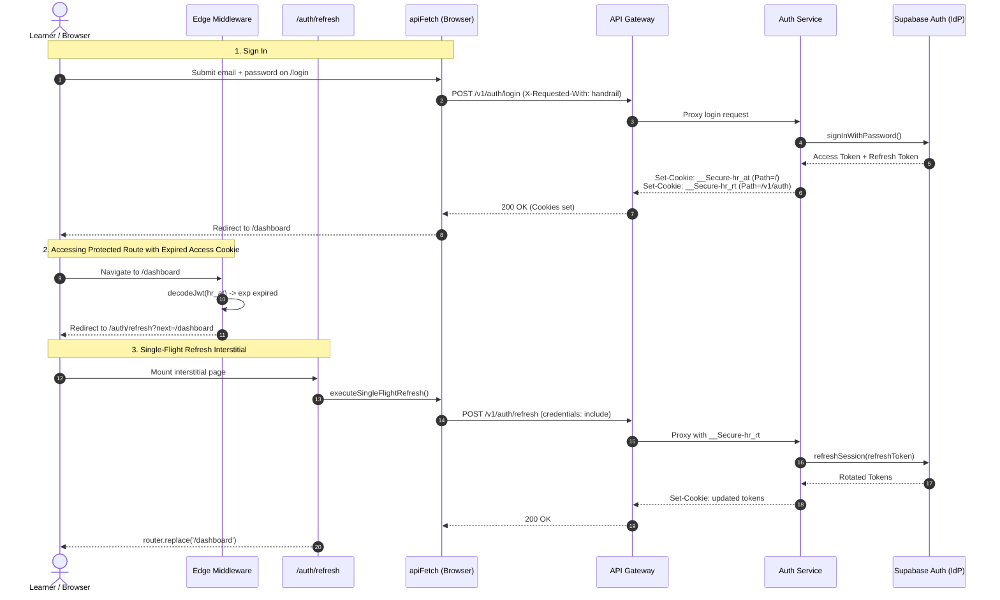

# Handrail Web Authentication Architecture (`apps/web`)

This document details the frontend authentication and authorization architecture implemented in `apps/web` (Next.js 15 App Router, React 19, TypeScript, Tailwind CSS, TanStack Query v5, Zustand UI-only state).

---

## 1. Architectural Principles & Guarantees

1. **Zero Supabase in `apps/web`**:
   - `apps/web` contains **zero** Supabase client libraries (`@supabase/supabase-js`, `@supabase/ssr`).
   - Enforced via ESLint rule (`no-restricted-imports`) and verified in CI via `tools/check-no-supabase.ts`.
   - All authentication routes proxy through the gateway at `/v1/auth/*`.

2. **Zero JavaScript-Readable Tokens**:
   - Tokens are stored exclusively in `HttpOnly` cookies set by `auth-service` via the API gateway:
     - `__Secure-hr_at`: Short-lived JWT access token (`Path=/`, `Max-Age=900..1800`, `SameSite=Lax`).
     - `__Secure-hr_rt`: Refresh token (`Path=/v1/auth`, `SameSite=Lax`).
   - Client-side React state and Zustand stores **never** hold access or refresh tokens. The exposed `session` object contains only user claims and expiration timestamp:
     ```ts
     interface Session {
       user: {
         id: string;
         email: string;
         displayName?: string;
         roles: string[];
         sessionId?: string;
       };
       expiresAt: number; // Unix timestamp in seconds
     }
     ```

3. **CSRF & CORS Gateway Compliance**:
   - Every browser request sends `credentials: 'include'` and the custom header `X-Requested-With: handrail`.
   - Non-GET/HEAD/OPTIONS requests without this custom header are rejected with HTTP 403 by the gateway.

4. **Open Redirect Defense**:
   - Every redirection target (`next`, `redirectTo`) is sanitized via `validateRedirectTarget(url, fallback)`.
   - Strictly accepts only same-origin relative paths starting with a single `/`.
   - Rejects protocol-relative paths (`//`), backslashes (`\`), URI schemes (`https:`, `javascript:`), and control characters.

5. **Static Prerendering Preservation**:
   - Public pages (`/`, `/workshops`, `/login`, `/signup`) remain 100% statically renderable (`○`).
   - Root layout and public routes **never** call `cookies()` or `headers()`.
   - Server-side session checks occur strictly within the `(app)` route group layout (`apps/web/src/app/(app)/layout.tsx`).

---

## 2. Authentication Flow



---

## 3. Tiered Implementation Structure

### Tier 1: Client Utilities (`apps/web/src/utils/auth/`)

- [`client.ts`](file:///d:/navneet_games/stepwsie/apps/web/src/utils/auth/client.ts):
  - `apiFetch<T>(path, init)`:
    - Base URL from `NEXT_PUBLIC_API_URL`.
    - Automatically injects `credentials: 'include'` and `X-Requested-With: handrail`.
    - Single-flight refresh mutex: concurrent 401s collapse into one shared `POST /v1/auth/refresh` call and retry original requests once.
    - Exposes typed SDK calls: `login`, `signup`, `logout`, `forgotPassword`, `resetPassword`, `changePassword`, `confirm`, `getSession`, and `startGitHubOAuth`.
- [`events.ts`](file:///d:/navneet_games/stepwsie/apps/web/src/utils/auth/events.ts):
  - Token-free event bus using `BroadcastChannel('handrail-auth')` with `localStorage` timestamp fallback for older browsers.
  - Emits: `SIGNED_IN`, `SIGNED_OUT`, `TOKEN_REFRESHED`, `SESSION_EXPIRED`.
- [`server.ts`](file:///d:/navneet_games/stepwsie/apps/web/src/utils/auth/server.ts):
  - `import 'server-only'` boundary preventing leakage to client bundles.
  - Asynchronous `getAccessToken()` reading `__Secure-hr_at` from `await cookies()`.
  - `serverFetch<T>(path, init)` calling `API_INTERNAL_URL` using `Authorization: Bearer <token>` with `cache: 'no-store'`. Omits cookies to comply with gateway CSRF protection.
  - `getServerSession()` wrapped in React `cache()`.
- [`routes.ts`](file:///d:/navneet_games/stepwsie/apps/web/src/utils/auth/routes.ts):
  - `validateRedirectTarget(url, fallback)`: Enforces safe relative destination.
  - `PROTECTED_PREFIXES`: `['/dashboard', '/settings', '/profile']`.
  - `AUTH_PAGES`: `['/login', '/signup', '/forgot-password', '/reset-password', '/auth/confirm']`.
- [`middleware.ts`](file:///d:/navneet_games/stepwsie/apps/web/src/utils/auth/middleware.ts):
  - Lightweight edge token expiration check via `jose.decodeJwt`.
  - If token is missing or expired on a protected route, redirects to `/auth/refresh?next=...`.
  - If token is valid on an auth page, redirects to `/dashboard`.
  - Injects `x-pathname` header for downstream Server Components.

---

### Tier 2: State Management & Reactive Data Fetching

- [`auth-context.tsx`](file:///d:/navneet_games/stepwsie/apps/web/src/context/auth-context.tsx):
  - `AuthProvider` wraps the application tree; manages the session query via TanStack Query v5 (`QUERY_KEYS.auth.session`).
  - Accepts optional `initialSession` for instant hydration from Server Components.
  - **Proactive Token Refresh**: Schedules timer at 75% of token lifetime or 60s before expiry.
  - **Tab Visibility Recovery**: Proactively refreshes the session when an inactive browser tab is refocused if within 60s of expiration.
  - **Cross-Tab Event Sync**: Subscribes to `authEventBus`. On `SIGNED_OUT` or `SESSION_EXPIRED`, invalidates session and removes user profile queries.
  - Role Helpers:
    - `hasRole(role: string): boolean`
    - `useRole(role: string): boolean`
    - `useRequireRole(role: string, redirectTo?: string)`
- [`use-profile.ts`](file:///d:/navneet_games/stepwsie/apps/web/src/hooks/use-profile.ts):
  - `useProfile()`: Queries `GET /v1/profile` via `apiFetch`, enabled only when authenticated.
  - `useUpdateProfile()`: Mutation for `PATCH /v1/profile` with optimistic cache update.
  - `usePreferences()` & `useUpdatePreferences()`: Query and mutation for `GET/PATCH /v1/preferences`.
  - `useActivity()`: Query for `GET /v1/activity`.
- [`ui-store.ts`](file:///d:/navneet_games/stepwsie/apps/web/src/stores/ui-store.ts):
  - Dedicated strictly to UI-only state (e.g., active level preferences, sidebar state). **Never** stores authentication tokens or session details.

---

### Tier 3: Presentation & Route Architecture

- **Auth Route Group `apps/web/src/app/(auth)/`**:
  - `layout.tsx`: Centered neo-brutalist authentication layout.
  - `/login`: Email + password form, GitHub OAuth button, stable error code mapping (`INVALID_CREDENTIALS`, `EMAIL_NOT_CONFIRMED`, `RATE_LIMITED`), session expiration alert (`reason=expired`).
  - `/signup`: Registration with password confirmation, min-8 character validation, GitHub OAuth.
  - `/forgot-password`: Password reset request form.
  - `/reset-password`: Password recovery form calling `resetPassword`.
- **Protected App Route Group `apps/web/src/app/(app)/`**:
  - `layout.tsx`: Server Component calling `await getServerSession()`. Unauthenticated requests redirect to `/login`. Pre-seeds `QueryClient` cache via `HydrationBoundary`.
  - `/dashboard`: Displays learner identity, role badges (`admin`, `staff`, `learner`), active track, and recent activity log.
  - `/settings`: Profile details updates, workshop preferences, and password change section.
- **Navbar Auth Slot**:
  - [`Navbar.tsx`](file:///d:/navneet_games/stepwsie/apps/web/src/components/layout/Navbar/Navbar.tsx) & [`NavActions.tsx`](file:///d:/navneet_games/stepwsie/apps/web/src/components/layout/Navbar/NavActions.tsx):
    - Renders loading skeleton while `isLoading`.
    - Authenticated users see an avatar pill with initials, display name, Dashboard link, Settings link, and Sign Out button.
    - Unauthenticated visitors see "Log in" and "Get started" buttons.

---

## 4. Verification & Testing Guide

### 1. Run Unit & Integration Tests
```bash
pnpm --filter web test
```
The test suite covers:
- Safe and unsafe redirect targets (open redirect defense).
- Route classifiers (`isProtectedRoute`, `isAuthPage`).
- Cross-tab and in-tab event bus synchronization.
- Single-flight refresh collapsing and retry behavior.
- Edge middleware redirection logic.
- `AuthProvider` state transitions and role checks.
- Profile and preferences hooks (`useProfile`, `usePreferences`).
- End-to-end authentication and profile loading flow.

### 2. Verify CI No-Supabase Constraint
```bash
node tools/check-no-supabase.ts
```
Scans `apps/web` to guarantee that no `@supabase/*` imports or packages exist.

### 3. Verify Next.js Production Build
```bash
pnpm --filter web build
```
Confirms that:
- All 14 routes compile with zero TypeScript or webpack errors.
- Public routes (`/`, `/workshops`, `/login`, etc.) remain statically prerendered (`○`).
- Guarded routes (`/dashboard`, `/settings`) execute dynamically on the server (`ƒ`).
